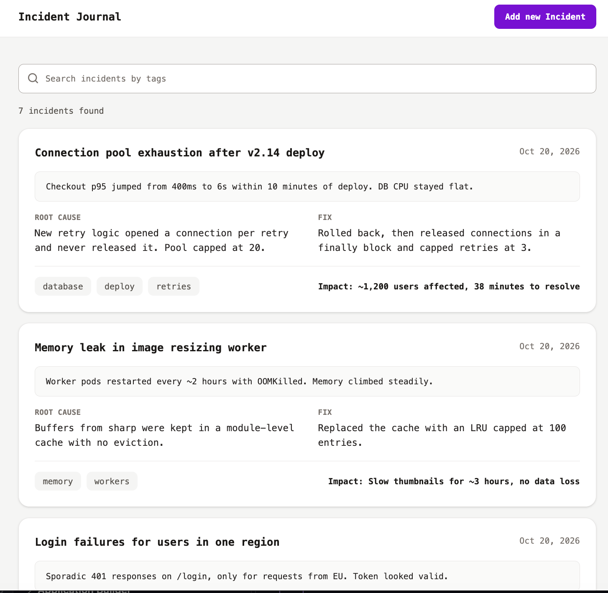
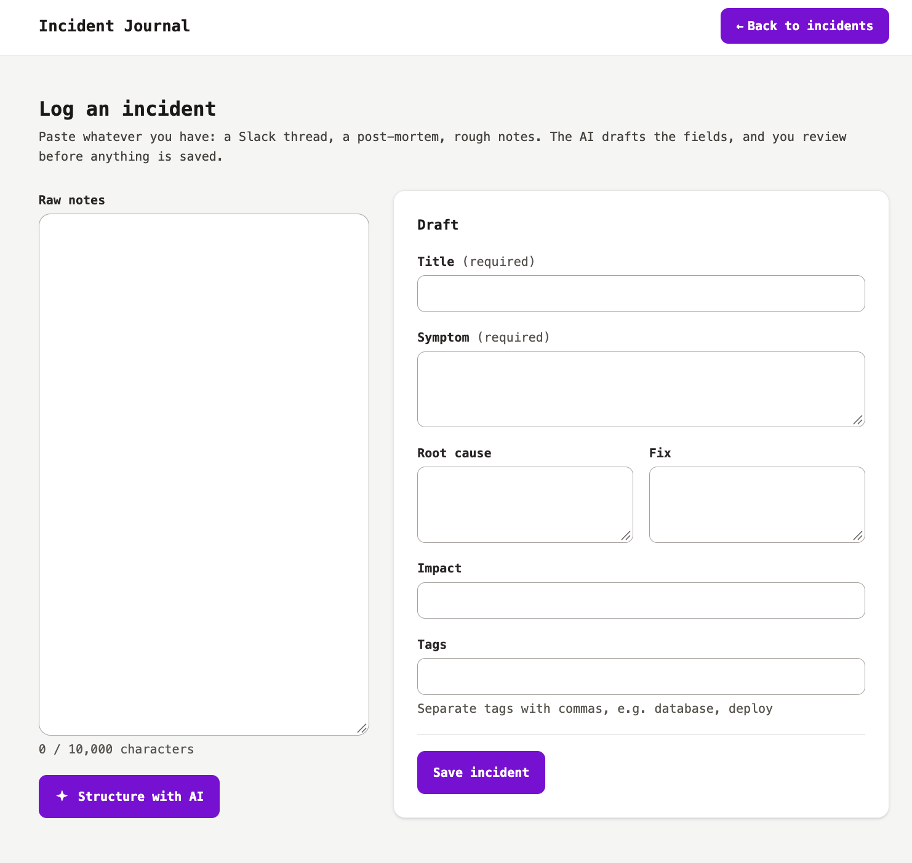

# Incident Journal

Paste messy notes from Slack, Teams, or a postmortem, and get a clean incident record: what broke, why, how it was fixed, and what it cost the business. Built with React, Node, TypeScript, and SQLite, with Claude drafting the form for you.




## Why I built this

At my last job, we kept re-fixing problems we had already solved. Nobody remembered how, and nobody could say what those incidents cost us.

It also hit me personally: when I left, I couldn't remember half of what I'd shipped. I had to dig through old chats and notes just to update my resume. So this started as a "wins tracker" for myself, then I realized small teams have the same problem. Now it's a shared place to log incidents, search them later, and show the impact of the work.

## How it works

1. Paste raw notes into the input box.
2. Claude drafts the form (title, symptom, root cause, fix, impact).
3. You review, edit, and save.
4. Filter your incidents by tag whenever the same thing breaks again.

The AI drafts, you decide. Nobody wants to fill out a form after fighting a fire, so the AI does the typing and you keep the judgment.

## Tech stack

React, Tailwind, Node/Express, TypeScript, SQLite, Claude (Haiku).

## How to run

**Prerequisites:** Node.js 22+, and an Anthropic API key (only needed for the AI draft).

```bash
npm run install:all              # installs root, client and server
npm run seed --prefix server     # optional: sample data
npm run dev                      # starts client and API
```

Create `server/.env` before starting:

```
ANTHROPIC_API_KEY=your-api-key
ANTHROPIC_MODEL=claude-haiku-5-5
```

| Variable        | Default                 | Purpose                     |
| --------------- | ----------------------- | --------------------------- |
| `CLIENT_ORIGIN` | `http://localhost:5173` | Origin allowed by CORS      |
| `DB_PATH`       | `./data/incidents.db`   | Location of the SQLite file |

- Client: http://localhost:5173
- API: http://localhost:3001/api/incidents (the client proxies `/api` to it)

## Trade-offs

**Client**

- **Tailwind:** fast to set up, less CSS to maintain.
- **fetch over axios:** simple JSON calls with no auth, so an extra dependency wasn't worth it.
- **Local state over global state:** components don't share data yet. A global store this early would be solving a problem I don't have.

**Server**

- **REST:** the UI is simple, and there's no mobile client that needs to fetch different fields.
- **Zod:** validates incoming requests and the model's output. I don't trust the model to always return the right shape, so every draft goes through a schema before it reaches the form.
- **Haiku:** the model only structures text, so the smallest tier is enough and keeps costs low.

**Database**

SQLite because it's zero setup for anyone cloning the repo. A NoSQL DB would work for one table, but v2 adds auth and analytics, and I can see the relationships growing (incidents per user, metrics over time). So I'd stay relational. I also hadn't used SQL in a while and wanted to get sharp again.

## Gotcha: search-as-you-type

I first built search on SQLite FTS5, with ranked results and highlighted matches. The problem: even with a 500ms debounce, typing a single word fired way too many requests, because every pause mid-word triggered a fetch.

For now I moved filtering to the client. It fetches everything once and filters by tag, which is instant with no per-keystroke requests. The cost is losing ranked, highlighted search over symptoms and titles.

To bring FTS back properly, I'd need request cancellation (so stale responses can't overwrite newer ones), client-side caching (so backspacing doesn't re-hit the server), and a minimum query length. That's the next iteration.

## How I used AI

Claude helped me brainstorm, talk through trade-offs, debug, build UI, and generate sample data. The app also uses Claude at runtime to draft incident forms from raw notes.

## API endpoints

Base URL: `http://localhost:3001/api/incidents`

| Method | Path                       | Description                              | Success                           |
| ------ | -------------------------- | ---------------------------------------- | --------------------------------- |
| GET    | `/api/incidents`           | List all incidents                       | `200` with `Incident[]`           |
| POST   | `/api/incidents`           | Create an incident                       | `201` with the created `Incident` |
| POST   | `/api/incidents/structure` | Return an incident draft from a raw note | `200` with `IncidentDraft`        |

Invalid payloads return `400` with a `details` array of field errors.

## Folder structure

```
incident-journal/
├── client/
│   └── src/
│       ├── components/   # UI pieces
│       ├── hooks/        # data fetching and filtering
│       ├── pages/
│       ├── Api.tsx       # fetch wrappers
│       └── main.tsx
└── server/
    ├── ai/               # Claude call + Zod schema for drafts
    ├── db/               # SQLite setup and queries
    ├── helpers/
    ├── routes/           # Express route handlers
    ├── test/
    ├── app.ts            # Express app and middleware
    └── index.ts          # server entry point
```

## What's next

- Full-text search with ranking and highlights
- Metrics: which kinds of incidents happen most
- Auth, so only authorized users can log incidents
- Pagination and a virtual list
- sessionStorage so an accidental refresh doesn't wipe the form
